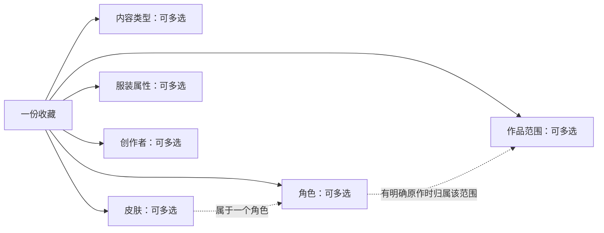

# 多维标签管理方案

日期：2026-10-08。状态：**六维管理已实现并验证，本文记录产品规则和设计依据；启动及验证结果见 [README](../README.md)，精确接口见 [V2 接口约定](v2-api-contract.md)。**

本文整理六个维度的管理、关联、检索和界面方案。自动解析、自动导入、网盘扫描与识别全部标记为 TODO。现有旧标签保留，用于人工映射和核对。

实现范围：接口采用统一候选和六类实体路径；迁移采用会话绑定预览、完整摘要复核及目录／收藏行锁，无需长期维护窗口。当前迁移只追加六维直接关联，旧标签继续保留；自动拆分、合并和删除旧记录暂缓。

## 1. 已确认需求与本方案的默认选择

用户已明确六个维度：类型、作品范围、角色、皮肤、服装属性、创作者。服装属性和创作者独立复用，各收藏按需关联。`cos`、`zw`、`do` 保留用户原文，不推测缩写的完整含义；“七零雪竹”沿用用户举例，不据此核定官方名称或实际服装。

旧版使用 `asset` 与 `tag` 多对多、`tag.parent_id` 单父关系，界面以树和完整路径为主。新版已切换六个独立维度的搜索和管理；旧树与关联仍保留用于核对和人工迁移。

当前实现采用以下规则：

- 六维都允许留空或多选；创建收藏仍只要求标题、文件形式等基本信息。
- 资源以整份收藏为整理单位，不细化到每张图片、每一帧或每个人的穿着。
- 角色按作品范围辨认，皮肤明确属于一个角色；类型、服装、创作者独立存在。
- “收藏关联皮肤”表示管理员确认收藏呈现该角色的该造型，因此推导角色及明确原作；界面区分直接选择与推导结果。借用其他角色的服装应标实际角色、服装和说明，边界见第 4 节。
- 不同维度之间要求全部满足；每个维度内部提供“全部／任一”，默认“全部”，延续现有默认行为。
- 先使用手动管理；自动解析和导入不会在这一步进入正式标签关联。

这些规则已进入当前实现；跨作品身份和更细粒度穿着关系仍可在后续版本讨论。

## 2. 统一术语与六个维度

**收藏条目**指系统中的一套图、一个视频或一份合集，继续使用 `asset`。**作品范围**指原作、游戏或动漫背景，例如王者荣耀、英雄联盟、某部动漫，避免与“这份收藏作品”混淆。

| 维度 | 代码 | 示例 | 管理规则 |
| --- | --- | --- | --- |
| 内容类型 | TYPE | cos、zw、do | 独立词表，一份收藏可以多选 |
| 作品范围／原作 | WORK | 王者荣耀、英雄联盟、某部动漫 | 独立条目，一份跨作品合集可以多选 |
| 角色 | CHARACTER | 公孙离、其他角色 | 记录所属原作；同名时展示原作或辨识备注 |
| 皮肤／角色造型 | SKIN | 七零雪竹、某个角色的另一造型 | 每条记录属于一个角色，同名皮肤按角色区分 |
| 服装与穿搭属性 | CLOTHING | 黑丝、白丝、旗袍、高跟鞋 | 跨类型、原作、角色和皮肤复用，按收藏实际内容选择 |
| 创作者 | CREATOR | 某位 UP、博主、Coser | 独立资料，合集允许多位，同名通过平台账号或备注辨认 |

`TYPE` 与现有 `asset.kind` 分开：前者描述内容，后者仍是 `VIDEO / IMAGE_SET / OTHER`，界面称“文件形式”。选择 cos 不能自动推断是图集，选择视频也不能自动推断内容类型。

作品范围、角色、皮肤对真人原创等内容可以为空。空白表示“尚未标记”，不自动断言“不适用”或“没有”。不根据 cos、zw、do 限制其他维度是否允许填写。

## 3. 关系：分面独立，角色和皮肤保留明确归属



图中的归属关系用于辨认实体、联动选择和有限推导。内容类型不成为角色的上级；同一个公孙离可以关联 cos 图集、插画等不同内容，而无需在不同类型下复制角色。

### 3.1 角色和作品范围

- 第一版一个角色记录可有一个作品范围，也允许暂时未指定原作。
- 名称相同、原作不同的角色使用不同 ID。选择器显示“角色 · 原作 / 名称”。
- 没有原作或同一范围内仍有同名人物时，使用辨识备注，例如“作者 A 的原创角色”；不强制建立虚构原作。
- 跨作品人物暂按作品中的角色版本区分。一个统一人物身份对应多个原作的需求列为后续讨论项；不会按名字自动合并，也不会把某个角色出现过的全部联动作品都推导到一份收藏上。
- 作品范围首版平铺管理。系列、续作、动漫／游戏大类与具体作品之间不自动建立上下级，也不自动推导跨范围命中。

### 3.2 皮肤和角色

- 皮肤必须选择所属角色；同一角色可以有多个皮肤。
- 管理页从角色行展开该角色的皮肤子列表，不再将皮肤作为并列顶层页签；子列表支持搜索、分页和固定归属的新建。收藏的皮肤检索仍保留。
- 角色可以暂时没有皮肤；不确定具体造型时可以只标角色，不自动创建或选择“默认皮肤”。
- 同名皮肤属于不同角色时，分别建立记录。共用的“旗袍”“高跟鞋”等穿搭词放入服装维度。
- 选择皮肤时界面始终展示所属角色；从某个角色打开皮肤选择器，只展示该角色的候选。
- 收藏允许包含多个角色、同一角色的多个皮肤，以及多个角色各自的皮肤。按角色分组展示已选造型，避免两个互不对应的独立列表。
- 正式关联以皮肤 ID 为准，由皮肤记录确定所属角色；界面分组不会允许把角色 A 与角色 B 的皮肤配成同一个造型。

### 3.3 服装属性独立复用

“黑丝”“白丝”“旗袍”“高跟鞋”都是收藏可选的实际内容标签。同一条服装标签可以关联任意收藏，无需在每个皮肤下重建。

选中某个皮肤，不自动认定收藏中出现了该皮肤设定中的全部服装。改造、混搭、局部拍摄、同一合集的不同穿搭都可能使这种推断失效。第一版只关联管理员明确选择的服装属性；皮肤常见服装推荐留作后续可选功能，推荐也不进入正式筛选结果。

### 3.4 创作者独立管理

- 创作者与登录账号、网盘存储来源分开。网盘分享者或上传账号不自动视为创作者。
- 一份收藏可以关联多位创作者；此关联只说明收藏与其有关，不自动断言对方是摄影师、出镜者或整份合集的唯一作者。
- 创作者资料包含显示名、辨识备注及可选的多个平台账号／主页链接。跨平台账号归为同一创作者需要人工确认。
- 同名创作者可以并存；编辑和关联使用 ID，不以昵称作为身份依据。

## 4. 收藏如何保存标签和展示推导

直接关联只保存管理员选中的六维实体 ID。本提案的皮肤标签表达“这份收藏呈现其所属角色的这个造型”，而非单纯“服装灵感来自这个皮肤”；在这个设计前提下，读取与检索按固定规则计算有效维度：

```text
有效类型   = 直接类型
有效皮肤   = 直接皮肤
有效角色   = 直接角色 ∪ 直接皮肤的所属角色
有效作品   = 直接作品 ∪ 有效角色的明确所属原作
有效服装   = 直接服装
有效创作者 = 直接创作者
```

推导只沿“皮肤 → 角色 → 明确所属原作”进行，不从原作反推所有角色、不从角色反推所有皮肤，不从上述关系推导内容类型、服装或创作者。

最强反例是角色 A 借用角色 B 的皮肤服装：皮肤的设定归属不证明 B 实际出现在资源里。按本提案的暂定语义，这类资源标角色 A、实际服装和说明，不直接关联 B 的皮肤；如果用户希望把 B 的皮肤也作为灵感标签检索，就应改为“所属角色仅供辨认、实际角色由管理员明确选择”，取消自动角色／原作推导。此处在实施前需要讨论确定，不能把自动推导当作天然正确的事实。

例如管理员直接选择：

| 维度 | 直接关联 | 页面补充展示 |
| --- | --- | --- |
| 类型 | cos | — |
| 作品范围 | 未直接选 | 王者荣耀 · 来自角色归属 |
| 角色 | 未直接选 | 公孙离 · 来自皮肤归属 |
| 皮肤 | 七零雪竹 | 显示其角色与原作上下文 |
| 服装 | 高跟鞋、旗袍 | 仅显示这两项，不添加其他穿搭 |
| 创作者 | 示例创作者 A | — |

这里的角色归属和原作归属为示例配置，不代表系统会按名字识别出来。管理员建立词表时需要明确填写关系。

直接项显示普通标签，推导项显示“来自皮肤／角色”的标记。响应分别返回 `directFacets`、`effectiveFacets`；推导项带 `derivedFrom`，指向最终的直接关联依据，不在数据库中复制一份伪装成手动关联。

取消一个直接角色，但仍保留其皮肤时，角色仍会出现在有效标签中。界面解释原因，并提供“同时移除该角色的已选皮肤”操作；有直接原作关联时不会连带移除它。相同有效实体只显示一次，多个推导依据可以展开查看。

原作待明确的角色仍可保存和检索，但不产生作品范围推导；之后补充归属会影响其已关联收藏的有效标签，适用后文的归属变更规则。

### 资源级标签的表达边界

一份合集标记“公孙离、甘雨、黑丝、白丝”，表示这份收藏包含这些标签。它不能证明哪个角色穿哪种袜子，也不能证明两个角色在同一张图或同一帧中出现。

皮肤与角色的固定归属可以正确配对；人物与服装、创作者与具体图片的对应关系没有在本版记录。若未来需要“只找公孙离本人穿黑丝的画面”，应再设计图片／片段或出镜对象级关联，而不是改变现有标签的解释。

## 5. 检索方案

### 5.1 两种输入有明确用途

- **收藏搜索**：查标题、说明，沿用现有文本搜索。
- **添加标签条件**：在六维词表中直接搜索名称或辨识上下文，选中具体候选后立即筛选收藏。

同名候选显示维度和上下文，例如：

```text
角色   王者荣耀 / 公孙离
皮肤   王者荣耀 / 公孙离 / 七零雪竹
服装   高跟鞋
创作者 示例创作者 A · 平台账号／辨识备注
```

用户可以从总标签搜索入口查任何维度，也可以打开某一个维度只查该维候选。上下文用于消歧，搜索和保存按 ID，不要求先展开作品或角色目录。名称搜索统一处理 NFC、首尾空白和大小写；`%`、`_` 作为普通字符。别名词典与同义词解析列为 TODO。

### 5.2 组合规则

不同维度之间固定 AND。每个已使用的维度内部可以选择 ALL（全部）或 ANY（任一），默认 ALL；空维度不参与筛选。

```text
类型：cos
角色：公孙离、甘雨［任一］
服装：旗袍、高跟鞋［全部］

含义：cos AND（公孙离 OR 甘雨）AND 旗袍 AND 高跟鞋
```

把角色维度切换为“全部”，表示同一份收藏同时包含公孙离和甘雨，不承诺同一张图出现两人。标题、文件形式、存储来源和标星继续与这组标签条件共同生效。

角色和原作筛选使用有效维度，因此只直接选皮肤的收藏仍可被其角色、原作找到。服装筛选只认实际直接服装关联。标签全部条件不能被普通 JOIN 行数放大；列表、总数与分页均按收藏去重。

选择角色 A 和角色 B 的皮肤时，界面分别标明上下文。若用户是在资源级分面中分别选它们，意思是收藏包含 A 和 B 的该皮肤；角色 A 的皮肤选择器则不会提供 B 的皮肤。两种交互不把条件解释成“A 穿着 B 的皮肤”。

### 5.3 其他筛选

- “完全未标注”：六维均没有直接关联的收藏。
- 各维度可单独选择“该维未标注”，按有效维度为空判定；不能与同维具体值同时启用。
- 清空标签搜索只清空候选检索词；移除条件或“清空全部筛选”才改变实际结果。
- 初版保持稳定分页与排序。若显示候选使用次数或筛选后的数量，必须按去重后的有效关联统计，不能用关联行数或固定示例数代替。

## 6. 界面与日常管理

### 6.1 我的收藏

首页以搜索、六维分面和收藏卡片为主：

```text
［搜索标题或说明］  ［添加标签条件：可搜索六个维度］

类型       [cos] [zw] [do] [更多]
作品范围   [搜索／选择]
角色       [搜索／选择]
皮肤       [搜索／选择]
服装属性   [黑丝] [白丝] [旗袍] [高跟鞋] [更多]
创作者     [搜索／选择]

已选：类型 cos；角色 公孙离；服装 旗袍＋高跟鞋［全部］
下方显示匹配收藏、分页与当前组合规则。
```

示意中的标签按钮来自管理员维护的词表，不要求内置这些用户示例。默认展示常用或最近使用项属于后续交互细节，不把全部词表一次铺满页面。

卡片可以按维度展示少量标签，详情展示完整六维和直接／推导来源。手机端用“筛选”面板展示同样的维度和条件，支持搜索、滚动、多选及单项移除。

### 6.2 新建／编辑收藏

1. 填写标题、文件形式、说明及外部位置。
2. 选择内容类型、作品范围，可留空或多选。
3. 添加角色和皮肤：可直接搜角色，也可先按原作缩小候选；已选皮肤按所属角色分组，角色下可选多个皮肤。原作限制只影响候选列表，不要求资源只能有一个原作。
4. 选择实际服装属性和创作者。多个角色、多个创作者不强制一一对应。
5. 保存前展示直接项和推导项，一次提交全部直接关联。

管理员目前在“标签整理”中建立词表，再在收藏选择器中关联；新建实体本身不自动关联当前收藏。选择器内快捷新建入口为 TODO。看客使用相同搜索与浏览能力，没有新建和编辑入口。

### 6.3 标签与资料管理

使用维度页签和搜索列表替代默认树目录，提供创建、改名、辨识备注、停用及查看相关收藏。皮肤在角色行展开管理，不占独立顶层页签。角色显示原作字段，皮肤显示所属角色；服装没有原作或角色父节点，创作者在列表和编辑表单展示平台资料。实体关联数量和创作者独立资料页为 TODO。

- 所有实体使用稳定 ID。TYPE、WORK、CLOTHING 的规范化名称在各自词表内唯一。
- CHARACTER 以原作作用域、规范化名称和辨识备注区分；空原作使用明确的统一作用域。同作用域同名同备注禁止重复，其他情况保留独立 ID。
- SKIN 在同一个角色下规范化名称唯一，跨角色允许同名。
- CREATOR 允许同名，通过辨识备注区分；规范化名称和辨识备注完全相同则提示已有记录并阻止重复创建。同名的不同创作者需补充不同辨识备注。平台账号只能按已明确的账号标识建立关联，不能按昵称自动合并。
- 普通改名保持 ID 和关联不变。改维度、合并实体、修改已有归属不是普通改名。
- 停用后不提供新增关联；旧收藏中的关联继续展示和检索，编辑其他字段时可以保留原关联，不被静默删除。提交时仅对“新直接 ID 集合减原直接 ID 集合”检查新增可用性，不因保留旧停用项拒绝整个更新。
- 新增角色／皮肤还检查其归属链：角色或明确原作停用时，不允许通过新选下级皮肤间接新增它；原作停用时也不能新增其角色。下级记录自身的启用字段不级联改写，但新建关联选择器显示不可用原因；历史直接关联及其推导项仍保留。收藏检索候选可以查停用项，新增关联候选与历史筛选候选使用不同用途参数。
- 只允许删除没有任何直接或间接引用的条目。被收藏使用、被角色引用的原作、被皮肤引用的角色都不能直接删除；建议先停用。
- 第一版对已有直接或间接收藏引用的角色原作、皮肤所属角色实行归属保护，普通编辑禁止改变。无引用时可检查版本后更正。已使用实体的归属修正与合并需另做影响预览、关联迁移和核对流程，列为后续管理功能。

## 7. 后端和数据库设计方向

### 7.1 选择关系型实体，界面统一成标签

继续使用 Java／Spring Boot、JdbcTemplate、MySQL、Flyway。六个维度固定，且原作、角色、皮肤有明确归属，因此已建立具体实体与关联表。

以下结构已由 Flyway V2 实现：

| 词表／实体 | 主要信息 | 收藏关联表 |
| --- | --- | --- |
| content_type | 名称、规范化名称、启用状态、版本 | asset_content_type |
| work_scope | 名称、规范化名称、备注、启用状态、版本 | asset_work_scope |
| catalog_character | 可空 work_scope_id、名称、辨识备注、规范化字段、状态、版本 | asset_character |
| skin | 必填 character_id、名称、规范化名称、状态、版本 | asset_skin |
| clothing_tag | 名称、规范化名称、备注、状态、版本 | asset_clothing |
| creator | 显示名、辨识备注、规范化字段、状态、版本 | asset_creator |

创作者的平台账号保存于 `creator_account`，一位创作者对应多条手动填写的账号／主页记录。它只保存身份资料，不保存登录密码、Cookie 或网盘访问令牌。

收藏关联表均以 `(asset_id, entity_id)` 为联合主键，并建立反向索引及真实外键。`catalog_character.work_scope_id`、`skin.character_id` 也使用外键。全部 ID 对外仍使用字符串，时间沿用 UTC。

空原作角色的作用域唯一性不能只依赖 MySQL 可空复合唯一键，当前使用生成列 `COALESCE(work_scope_id, 0)`；0 不作为真实实体 ID。角色和创作者的 `normalized_disambiguation` 均为 `NOT NULL DEFAULT ''`，避免空备注绕过唯一键。角色唯一键为 `(work_scope_key, normalized_name, normalized_disambiguation)`，创作者为 `(normalized_name, normalized_disambiguation)`；具体定义见 V2 迁移，实际 MySQL 集成测试已验证同名与作用域约束。

推导关系在查询／服务层计算。MySQL 的 `EXISTS`、固定关系 JOIN 和集合去重可以表达此模型，首版不引入图数据库或搜索集群。索引、计数查询与分页性能需要在实际样本上验证，文档不宣称已达到某个规模或响应时间。

### 7.2 写入、一致性与权限

- 六维直接关联和收藏基本信息在一个事务内保存；检查 `asset.version`，成功后递增，旧版本返回 409。
- 普通实体改名／停用检查实体版本，不改变收藏的直接 ID 关联。查看时使用最新名称和状态。
- 词表删除、角色原作更正、皮肤角色更正与收藏关联写入遵循统一锁顺序，第一版可使用固定目录协调锁串行保护低频变更，防止“检查无引用”后被并发引用。
- 未来实现已使用实体的归属修正时，先给出影响范围，再在事务中修改关系并递增受影响收藏版本；未完成这套流程前保持归属保护。
- 管理员维护词表、关联和创作者资料；看客只读检索。后端授权、Session、CSRF、账号安全规则沿用，新增路径必须显式授权。
- 类型、原作和角色等从已有列表传入的 ID 必须由服务端校验；前端联动筛选不能代替后端的归属、存在性以及新增集合的停用／归属链校验。更新时保留原有停用关联和新增停用关联必须区别处理。

### 7.3 接口概览

新模型使用 `/api/v2`，与只读旧接口分开。以下为已实现的接口概览，精确请求字段见 [接口约定](v2-api-contract.md)：

| 接口 | 用途 |
| --- | --- |
| GET /api/v2/catalog/search | 按 q 和可选维度搜索统一候选，返回 ID、维度、名称、上下文、状态并分页 |
| GET /api/v2/catalog/types、work-scopes、characters、skins、clothing、creators | 六类管理列表；角色支持原作条件，皮肤支持角色条件 |
| POST／PUT／DELETE 对应实体路径 | 管理员新增、更新或删除；按版本和引用规则执行 |
| GET /api/v2/assets | 文本、文件形式、来源、标星及六维 ID／模式组合筛选 |
| POST／PUT /api/v2/assets[/{id}] | 一次保存基本信息和六维直接关联；位置继续沿用明确的独立修改操作 |
| GET /api/v2/assets/{id} | 返回直接维度、有效维度、推导依据与外部位置 |

收藏查询为每维设置 ID 数组和 ALL／ANY，例如 `characterIds=11,12&characterMode=ANY&clothingIds=31,32&clothingMode=ALL`。模式缺省为 ALL；未知模式、页码小于 1、每页数量超出约定范围、不存在的 ID、同维同时指定“未标注”和具体值返回明确的 400。超过结果末页返回空列表与正确总数。ID 去重后再生成条件。

GET 只读取。六类列表在表格中合并展示，实际为各自独立路径；统一搜索使用 `/catalog/search`。DTO、分页上限和查询规则已实现并测试。

## 8. 现有层级标签的迁移

旧树的层级不能可靠说明新维度，不能按名称或所在层数自动认定是角色、服装或创作者。例如 `Cos / 公孙离 / 七零雪竹` 缺少原作字段，迁移工具不能仅凭这些名称填入“王者荣耀”。

当前操作流程：

1. 备份数据库并核对记录数量。启动新版，由 Flyway V2 增加新表；不修改已执行的 V1，不自动改变旧业务记录。
2. 在“标签整理 → 旧标签迁移”建立旧节点到新实体的人工映射，保存旧 ID、新维度和新 ID。一个旧节点可对应多个目标，无法判断的先保留待归类。映射处理人和审计状态为 TODO。
3. 管理员确认原作、角色和皮肤归属；不同分支中的同名节点不能直接自动合并。
4. 按每份收藏的旧直接标签以及旧祖先的筛选含义生成迁移预览。例如只绑定旧皮肤节点的收藏，原来能被 Cos 找到，新模型需要明确补出相应 TYPE 关联；不能只迁移直接叶子后丢失旧类别含义。
5. 确认应用时，在目录协调锁和收藏行锁内重新比较完整摘要。数据变化返回 409，要求重新生成预览；一致时事务性追加新关联并递增发生变化的收藏版本，不覆盖原关联。重复应用新的相同预览不会重复关联或递增版本。
6. 核对直接／推导展示与检索结果。网页已使用新接口，旧收藏和标签写接口默认只读。未分类旧数据继续可见，详情保留“旧标签／待归类”及原始路径。回滚须考虑升级后的新写入，不能简单恢复旧代码丢失新维关联。

这一步属于显式数据结构迁移，区别于未来从硬盘或网盘自动解析资源的 TODO。当前未读取、猜测或更改个人库中的任何已有标签。

## 9. 实施顺序与验收场景

已完成六维词表与资料管理、收藏手动多维关联及推导、标签搜索与分面检索、迁移预览与确认，以及手机体验验证。原文件与存储位置保持独立。

| 场景 | 预期行为 |
| --- | --- |
| 一份无原作的真人原创视频 | 可只选内容类型、服装、创作者；原作／角色／皮肤为空不阻止保存 |
| 一份收藏直接选某皮肤 | 可按其角色、已明确原作找到；推导来源可见 |
| 选择皮肤但不选高跟鞋 | 不命中“服装：高跟鞋”，即使常见设定包含该服装 |
| 不同原作有同名角色 | 分别检索和关联，候选有原作上下文 |
| 不同角色有同名皮肤 | 分别保存，不能在角色 A 的皮肤列表中误选 B 的皮肤 |
| 多角色、多原作、多作者合集 | 六维按需多选；列表与总数按收藏去重 |
| 角色维度选择两人 | ALL 表示同一收藏同时包含；ANY 表示至少包含其中一人 |
| 移除直接角色但保留所属皮肤 | 角色仍作为推导项显示，可明确同时移除皮肤 |
| 使用中的实体被停用 | 原关联继续显示、可检索，编辑无关字段可保留，不新增关联 |
| 角色或原作停用但下级皮肤仍启用 | 历史关联保留；新增皮肤关联因归属链停用被阻止 |
| 修改被收藏使用的角色／皮肤归属 | 普通编辑被阻止，不静默改变已收藏内容的解释 |
| 两个管理员同时编辑收藏 | 版本冲突返回 409，六维关联不被部分覆盖 |
| 看客构造写请求 | 后端拒绝，不能仅靠隐藏按钮保护 |
| 旧叶子标签迁移 | 预览保留原来父级检索的含义，无法确认的留待归类 |

当前实现已实际运行 62 项单元／MySQL 集成测试，并完成六维操作和旧标签迁移的浏览器检查；具体覆盖与部署验证边界见 README。以上行为仍作为后续修改的验收标准。

## 10. TODO 与后续讨论

本轮已实现手动管理；以下自动化和后续功能仍未实现：

- [ ] 文件名、目录路径、介绍文字的自动解析和批量导入。
- [ ] PikPak／百度网盘授权、列目录、扫描与同步；接入能力需逐个平台验证。
- [ ] 别名、同义词与规则词典；自动识别角色、服装、创作者。
- [ ] 候选标签的待确认、接受、拒绝及重新解析机制。
- [ ] 标签来源与原始依据记录；自动结果不能覆盖已确认的手动整理。
- [ ] 图片／视频识别、AI 打标、封面与 GIF／OSS 预览。
- [ ] 已使用实体的合并、拆分、归属修正及其影响核对工具。

下一轮优先讨论四个设计默认值：角色按原作版本还是统一人物身份整理；皮肤关联是否确认呈现其所属角色，进而允许推导角色／原作；各维内部默认 ALL 是否合适；创作者关联是否还需要区分出镜、摄影和发布角色。自动解析方式在管理模型定下来后再讨论。
