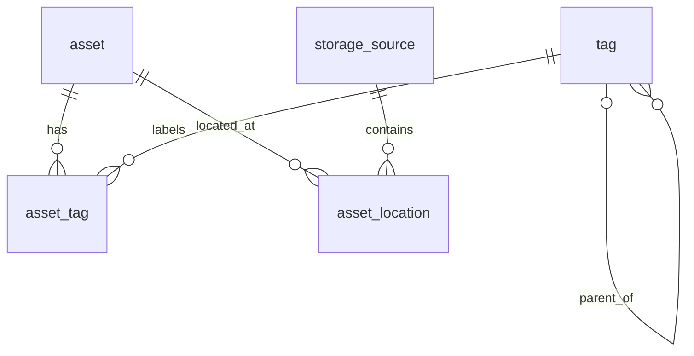

# 第一阶段设计：收藏目录与外部位置

日期：2026-10-08。本文记录功能、数据库及接口设计基线；当前代码、启动方式及验证结果见 [README](../README.md)。

下一阶段的六维标签提案见 [多维标签管理方案](multidimensional-tag-management.md)。它整理类型、作品范围、角色、皮肤、服装属性和创作者的关系与检索方式，尚未实施；本文继续描述当前层级标签基线。

## 目标与边界

在电脑或手机网页中，记录收藏内容、标签及其存放位置，回答“我收藏了什么、在哪个硬盘或网盘、如何找到”。

当前包括：

1. 管理员 ADMIN 与看客 VIEWER 登录、退出和自身信息查询。
2. 手动创建、查看、修改和删除收藏记录。
3. 层级标签管理，一个收藏可关联多个标签，并按多个标签组合筛选。
4. 管理具体存储来源，例如“移动硬盘 A”“我的百度网盘”。
5. 一个收藏关联多个外部位置。
6. 按标题、类型、标签和来源搜索，稳定排序并分页。
7. 手动标记来源状态，展示来源状态的报告时间。
8. 管理员创建、停用账号及分配角色；登录用户可验证旧密码后修改自己的密码。

暂缓：图片、GIF、封面与预览存储，OSS 接入，网盘授权与自动同步，本地扫描 Agent，视频在线播放及转码，专题清单，推荐算法。

## 用户与权限

默认各账号登录后查看同一收藏库，按角色区分能否修改。当前不做按账号隔离收藏，也不做逐条内容的可见性设置。看客属于已登录用户，未登录访客不能浏览收藏。

| 操作 | 管理员 ADMIN | 看客 VIEWER |
| --- | --- | --- |
| 查看、搜索、筛选收藏及详情 | 允许 | 允许 |
| 查看标签、来源、来源状态、位置与链接 | 允许 | 允许 |
| 新增、修改、删除收藏和位置 | 允许 | 禁止 |
| 新增、修改、删除标签和来源 | 允许 | 禁止 |
| 修改标星和来源报告状态 | 允许 | 禁止 |
| 查看账号列表、创建或停用账号、分配角色、重置密码 | 允许 | 禁止 |
| 查看自身非敏感资料、验证旧密码后修改自身密码、退出登录 | 允许 | 允许 |

“只读”指不能修改共享收藏业务数据，不禁止退出登录或修改自己的密码。看客可读范围默认包含位置中的路径和原始页面链接；账号管理信息、密码哈希和网盘凭据不在此范围内。当前没有网盘授权能力。

所有业务权限由后端决定：Spring Security 按明确的路径和 HTTP 方法授权，关键写服务使用方法授权复核。前端隐藏编辑按钮只是界面表现。未列入授权规则的新接口默认拒绝。业务 GET 接口不承担新增、修改、删除行为。

固定两个角色，不增加角色、权限及关联表；`app_user.role` 保存 ADMIN 或 VIEWER，每个账号有且仅有一个角色。请求中自带的角色声明不能作为身份依据。

## 先明确三个概念

- **收藏条目 `asset`**：用户整理的一份逻辑内容，可以是一个视频、一套图片或其他资源。图片类型只登记文字元数据，当前不处理图片文件。
- **存储来源 `storage_source`**：具体的设备或网盘实例。两块硬盘是两个来源，不是都归成一个“硬盘”记录。
- **位置 `asset_location`**：某个收藏在某个来源中的存放记录。同一个视频在硬盘和网盘各有一份，就有两个位置。

专题清单 `collection` 留到后续；一套图本身可以直接作为一个收藏条目，无需先创建清单再创建文件列表。

## 用层级标签整理资源

第一阶段以标签作为主要整理方式，无需再建立一套文件夹分类。标签的层级用于浏览和筛选，不改变硬盘、网盘中的原始目录，也不取代资源的位置记录。

示例标签树：

```text
Cos
├── 公孙离
└── 甘雨
风格
├── 古风
└── 日常
作者
└── 示例作者 A
```

同一个收藏可以同时关联 `Cos / 公孙离`、`风格 / 古风`、`作者 / 示例作者 A`。每个标签可以关联很多收藏，每个收藏也可以关联很多标签。允许资源暂时没有标签，界面的“未分类”是查询入口，不创建一个强制绑定的特殊标签。

筛选及绑定规则：

- 选中 `Cos`，匹配直接绑定 Cos 或其任意后代标签的资源；只绑定公孙离也能被找到。
- 选中 `公孙离`，匹配公孙离及其后代，不把仅绑定 Cos 的资源算进来。
- 同时选择公孙离与古风，默认要求两个条件都满足；每个条件各自包含后代。界面明确显示“同时满足”。
- 资源只保存管理员直接选择的标签，不自动写入祖先关联。详情展示直接标签及完整路径，避免把推导的上级误认为直接绑定。
- 可以直接绑定非叶子标签，也允许明确同时绑定父标签和子标签；不强制清理这种冗余。这样新增子标签或移动标签时，不会使已有绑定突然非法。
- 一个标签最多一个父标签，可以有多个根标签。不同父节点下允许同名，视为两个独立标签，选择器展示完整路径；同一父节点下禁止规范化后重名。

当前采用单父树。若同一个“公孙离”未来需要同时出现在 Cos 和游戏角色两条分支，可先把角色独立成一个分支，让资源同时绑定 Cos 与角色标签；同一节点具有多个父节点的结构留到明确需要时再设计。

管理员可以新增、重命名和移动标签；看客只读和筛选。移动标签不修改任何资源的直接绑定，但会改变父标签筛选结果及显示路径，操作界面需提示这种影响。有子标签时禁止直接删除，先由管理员移动或删除子标签；不提供一键递归删除。



## 数据库设计

采用 MySQL 8.4 LTS、InnoDB、utf8mb4。时间统一按 UTC 存取，在界面按用户时区显示。以下字段长度、索引和约束需在实际迁移脚本中落实并验证。

共 6 张核心业务表：`app_user`、`asset`、`tag`、`asset_tag`、`storage_source`、`asset_location`。另用 1 张辅助表 `app_guard` 保存固定的事务协调锁定行，不承载收藏或用户权限数据。

### app_guard：事务协调

只有 `guard_key VARCHAR(32)` 主键，由迁移脚本预置 `ADMIN_INVARIANT` 和 `TAG_TREE` 两行，不开放管理接口。需要保护相应不变量的写事务先 `SELECT ... FOR UPDATE` 锁定对应行，再读取及校验业务状态，锁持有至提交或回滚。若固定行缺失，操作失败，不能退化成无锁更新。

这些写事务采用 READ COMMITTED，在取得协调锁之后读取状态。管理员角色或启用状态变更使用 ADMIN_INVARIANT；标签创建、改名、移动、删除，以及收藏的标签集合写入使用 TAG_TREE。创建、修改或删除收藏中涉及标签关联的操作，也遵守先取得 TAG_TREE、再锁业务行的顺序。后者按固定顺序锁定有关收藏或标签；删除标签时对受影响收藏按 ID 顺序处理。首版优先让低频整理操作串行，后续只有实测成为瓶颈时才细化锁范围。此处为待实现并验证的并发策略。

### app_user：登录账号

| 字段 | 建议类型 | 含义 |
| --- | --- | --- |
| id | BIGINT 主键 | 用户 ID，对外作为字符串返回 |
| username | VARCHAR(64) | 展示及登录名称 |
| normalized_username | VARCHAR(64)，唯一 | 固定规范化规则后的唯一登录名 |
| password_hash | VARCHAR(255) | 使用 Spring Security PasswordEncoder 生成的单向密码哈希；不保存明文，接口永不返回 |
| role | VARCHAR(16) | ADMIN / VIEWER，创建账号默认 VIEWER |
| enabled | BOOLEAN | 是否启用 |
| security_version | BIGINT | 停用、角色变化和密码变化时递增，用于拒绝旧会话 |
| version | BIGINT | 管理账号时的乐观锁版本 |
| created_at / updated_at | DATETIME(6) | 创建及更新时间 |

无公开注册入口。首次初始化仅在用户表为空时，从部署配置或一次性初始化流程创建首个管理员；不内置默认密码，重启不重置已有账号、密码或启用状态。其他账号由管理员创建。

首版提供停用，不提供账号硬删除。账号停用、角色或密码变化不修改共享收藏，也不级联删除业务数据。

至少保留一个启用的管理员。角色和启用状态变更需在事务内先取得 ADMIN_INVARIANT 协调锁，再校验管理员数量并更新目标账号及其版本；不能用没有锁保护的“先查人数，再修改”。初始化首个管理员也取得同一锁再判断用户表是否为空。编码时需用并发场景验证。

会话保存登录时的用户 ID 与 `security_version`。每次受保护请求检查账号当前是否启用以及版本是否一致；不一致则使旧会话失效并返回 401。由此让停用、降级、管理员重置密码和用户改密在后续请求生效；不承诺撤回已经完成授权或执行中的请求。重新登录后按当前角色决定权限。

### asset：收藏条目

| 字段 | 建议类型 | 含义 |
| --- | --- | --- |
| id | BIGINT 主键 | 对外 JSON 作为字符串返回，避免 JavaScript 大整数精度问题 |
| title | VARCHAR(255) | 去除首尾空白后非空；不同收藏可以同名 |
| kind | VARCHAR(24) | VIDEO / IMAGE_SET / OTHER |
| description | TEXT，可空 | 用户备注，按纯文本处理 |
| favorite | BOOLEAN | 是否标星，默认 false |
| version | BIGINT | 乐观锁版本，创建时为 0 |
| created_at | DATETIME(6) | 创建时间 |
| updated_at | DATETIME(6) | 最近更新时间 |

### tag：标签

| 字段 | 建议类型 | 含义 |
| --- | --- | --- |
| id | BIGINT 主键 | 标签 ID |
| parent_id | BIGINT，可空，外键 | 指向 tag.id；NULL 表示根标签，每个标签最多一个父节点 |
| name | VARCHAR(64) | 展示名称 |
| normalized_name | VARCHAR(64) | 应用统一规范化后的名称，在同一个父节点下唯一 |
| parent_scope | BIGINT，生成列 | COALESCE(parent_id, 0)，用于约束根节点及子节点的同级重名 |
| version | BIGINT | 改名、移动、删除时检查的乐观锁版本 |
| created_at / updated_at | DATETIME(6) | 创建及更新时间 |

规范化规则在实现时固定：Unicode NFC、去除首尾空白、按 Locale.ROOT 转小写；规范化后仍检查长度和非空。唯一键的比较语义使用明确的二进制排序规则，与应用规范化结果保持一致。

唯一键为 `(parent_scope, normalized_name)`，正常标签 ID 限定为正数，0 仅为生成列中的根作用域。不能只用 `(parent_id, normalized_name)` 的唯一键约束根标签，因为 MySQL 唯一索引允许多条 NULL 值。增加 `(parent_id, id)` 索引支持遍历；父节点外键使用 RESTRICT，不级联删除整棵子树。具体生成列和约束在 MySQL 迁移时验证。

层级写入取得 TAG_TREE 协调锁后，检查父节点存在、父节点不是自己或自己的后代。最大深度先按 8 层设计，根为第 1 层；这是可调整的产品默认值。移动时计算整个被移动子树的最终深度，不能只检查目标节点。仅有外键、单条乐观锁或无锁环检测不足以阻止并发产生环，需验证 A 移到 B 下与 B 移到 A 下同时提交的情况。

父及后代查询使用 MySQL 8.4 的递归 CTE；不新增闭包表、图数据库或树路径缓存。设置递归边界和查询超时，异常结构不能静默截断后当作完整结果返回。查询性能需在样本数据上测量。

### asset_tag：收藏与标签

- `asset_id`、`tag_id` 组成联合主键。
- 外键指向收藏和标签。删除收藏或标签时，仅删除这张关联表中的对应记录。
- 增加 `(tag_id, asset_id)` 索引，支持按标签查收藏。
- 仅记录直接绑定，不保存由层级推导出的祖先关联；一个资源可绑定任意层级及不同分支的多个标签。

### storage_source：存储来源

| 字段 | 建议类型 | 含义 |
| --- | --- | --- |
| id | BIGINT 主键 | 来源 ID |
| name | VARCHAR(128) | 人可读名称，例如“移动硬盘 A” |
| type | VARCHAR(24) | LOCAL_DISK / PIKPAK / BAIDU |
| reported_status | VARCHAR(16) | UNKNOWN / ONLINE / OFFLINE，默认 UNKNOWN |
| status_reported_at | DATETIME(6)，可空 | 最近一次由用户报告状态的时间 |
| note | TEXT，可空 | 来源备注 |
| version | BIGINT | 修改来源或状态时一起检查并递增 |
| created_at / updated_at | DATETIME(6) | 创建及更新时间 |

来源表不保存网盘账号密码、Cookie 或访问令牌。应用登录账号的密码哈希独立保存在 `app_user`。没有实际探测前，不把状态命名为“实时在线”或“已验证”。

### asset_location：外部位置

| 字段 | 建议类型 | 含义 |
| --- | --- | --- |
| id | BIGINT 主键 | 位置 ID |
| asset_id | BIGINT，外键 | 对应收藏 |
| source_id | BIGINT，外键 | 对应来源 |
| locator_type | VARCHAR(24) | LOCAL_PATH / CLOUD_PATH / WEB_URL |
| locator | TEXT | 本地路径、网盘目录或原始页面 URL，当前仅作文本元数据 |
| note | TEXT，可空 | 用户的位置说明 |
| created_at / updated_at | DATETIME(6) | 创建及更新时间 |

LOCAL_DISK 允许 LOCAL_PATH；网盘来源允许 CLOUD_PATH 或 WEB_URL。URL 仅允许 HTTPS，拒绝脚本协议及嵌入用户名密码的 URL。要求填写稳定的原始页面链接，对已知临时链接格式作提示或拒绝；不同平台签名规则不同，不承诺识别所有会过期的链接。网页按文本展示路径，对外链接使用安全的新窗口属性。

第一阶段不自动判断两个位置是否为相同内容，也不基于文件名执行去重。

### 删除与一致性

- 删除收藏采用事务，删除其位置和标签关联，再删除收藏记录；不访问外部来源，也不删除原文件。
- 删除标签需携带标签预期版本；有子节点则返回 409。允许删除的标签只移除自身及其资源关联，保留收藏与原文件，并在同一事务内递增受影响收藏的版本，避免旧的标签集合编辑覆盖最新状态。
- 来源仍被位置引用时禁止删除，返回 409；数据库外键同时限制误删。用户需先修改或移除位置。
- 来源标记 OFFLINE 时，保留全部收藏和位置。来源离线不能推导为文件不存在。
- 修改收藏时在一个事务内检查 `version`、更新条目及标签集合；旧版本提交返回 409，避免两台设备互相覆盖。
- 位置变更作为收藏整体变更处理，同样检查并递增所属收藏的版本。

## 接口建议

除登录及获取 CSRF 令牌的必要入口外，业务接口要求登录。登录前获取 CSRF 令牌也不能泄露收藏数据。使用服务端 Session，写操作保留 CSRF 校验。浏览收藏、标签、来源和位置允许 ADMIN、VIEWER；对这些资源的所有修改仅 ADMIN 可用。账号管理路径下的读取和修改均仅 ADMIN 可用。

### 身份

| 方法与路径 | 用途 |
| --- | --- |
| GET /api/auth/csrf | 获取前端提交写请求所需的 CSRF 令牌 |
| POST /api/auth/login | 使用用户名和密码登录，由数据库账号记录决定角色和启用状态 |
| POST /api/auth/logout | 退出并失效会话 |
| GET /api/auth/me | 返回当前用户 ID、用户名和角色；不返回密码哈希或会话凭据 |
| PUT /api/auth/password | ADMIN、VIEWER 均可验证旧密码后修改自己的密码，并使全部旧会话失效 |

修改自身密码的请求只接受旧密码和新密码，目标账号取自当前身份；不接受用户 ID、角色、启用状态等管理字段。业务写请求和身份操作分别定义规则，不能简单将所有 POST / PUT / DELETE 都限定为管理员。

### 管理员账号管理

以下路径所有操作仅 ADMIN 可用，查看账号列表也不对 VIEWER 开放。账户响应永不包含密码哈希。

| 方法与路径 | 用途 |
| --- | --- |
| GET /api/admin/users | 查看账号列表、角色和启用状态 |
| POST /api/admin/users | 创建账号，角色默认 VIEWER，也可由管理员明确指定 ADMIN |
| PUT /api/admin/users/{id}/role | 携带 version 修改角色，检查至少保留一个启用管理员 |
| PUT /api/admin/users/{id}/status | 携带 version 启用或停用账号，检查至少保留一个启用管理员 |
| POST /api/admin/users/{id}/reset-password | 携带 version 设置新密码，使该账号的旧会话失效 |

管理员修改自己角色或停用自己也遵守相同约束：必须仍有其他启用管理员，且自己的旧会话在后续请求失效。用户角色变更、启用状态和密码变更时同步递增 `security_version` 与 `version`。用户名第一阶段创建后不修改。

### 收藏

| 方法与路径 | 用途 |
| --- | --- |
| GET /api/assets | 搜索、筛选、分页 |
| POST /api/assets | 创建条目，可同时提交 tagIds 和初始位置 |
| GET /api/assets/{id} | 详情，包含直接标签及其完整路径、位置和来源报告状态 |
| PUT /api/assets/{id} | 修改标题、类型、说明、标星和标签集合，携带 version |
| DELETE /api/assets/{id} | 删除业务记录，携带预期版本；不操作原文件 |
| POST /api/assets/{id}/locations | 添加位置，携带收藏预期版本 |
| PUT /api/assets/{id}/locations/{locationId} | 修改位置，携带收藏预期版本 |
| DELETE /api/assets/{id}/locations/{locationId} | 移除位置记录，携带收藏预期版本 |

收藏 JSON 示例：

```json
{
  "title": "示例影片",
  "kind": "VIDEO",
  "description": "演示条目，无真实资源",
  "favorite": false,
  "tagIds": ["11", "12"],
  "locations": [
    {
      "sourceId": "3",
      "locatorType": "CLOUD_PATH",
      "locator": "/示例目录/示例影片.mp4"
    }
  ]
}
```

### 标签与来源

| 方法与路径 | 用途 |
| --- | --- |
| GET /api/tags | 分页列表及名称搜索，返回 parentId 和完整路径，区分不同分支中的同名标签 |
| GET /api/tags/tree | 返回标签树，供浏览与多选；两角色均可读取 |
| POST /api/tags | 提交 name、parentId 创建标签，parentId 为 null 则创建根标签；同级重名返回 409 |
| PUT /api/tags/{id} | 携带 version 修改名称或 parentId；校验环、深度及目标分支重名 |
| DELETE /api/tags/{id} | 携带 version 删除标签及资源关联；有子节点返回 409，保留资源 |
| GET /api/sources | 列出具体来源及报告状态 |
| POST /api/sources | 创建来源 |
| PUT /api/sources/{id} | 携带 version 修改名称和备注；来源类型创建后不可修改 |
| PUT /api/sources/{id}/reported-status | 手动更新报告状态和时间，携带来源 version |
| DELETE /api/sources/{id} | 无引用时删除，否则返回 409 |

### 查询和错误语义

列表参数：`q`、`kind`、`tagIds`、`sourceId`、`favorite`、`page`、`size`。页码从 1 开始，默认每页 20 条，最多 100 条。

- `q`：对标题和说明作字面包含搜索，参数化查询，并转义 LIKE 中的 `%`、`_` 和转义字符。
- 每个 tagId 匹配该标签自身及全部后代，多个 tagId 默认要求每个条件都匹配；未传标签时不限制。重复 ID 去重，不存在的筛选 ID 返回 400。
- 查询按“每个选中标签是否有匹配的直接绑定”判断，不把展开后的后代标签混成一个普通 IN 查询，否则会错误变成任意匹配。若同时选择祖先和后代，可省去冗余的祖先筛选条件，但不能修改实际绑定。
- 一个资源即使命中同一分支的多个标签，也只返回并计数一次；分页与总数使用相同的层级筛选规则。
- 来源筛选使用 `EXISTS` 等方式避免同一条目因多个位置而重复返回或重复计数。
- 默认排序 `created_at DESC, id DESC`。普通分页不承诺跨多个请求的数据快照一致性。
- 初始索引：收藏 `(created_at, id)`、`(kind, created_at, id)`；位置 `(asset_id, id)`、`(source_id, asset_id)`。其他索引按实际查询计划添加。
- 标题包含查询不能假设普通 B-tree 索引已解决性能问题，需用样本验证。
- 400：参数错误、非法层级或超出深度；401：未登录；403：无权限或 CSRF 不通过；404：记录不存在；409：版本冲突、同级标签重名、标签仍有子节点或来源被引用。
- 错误响应提供稳定错误码及简洁说明，不返回 SQL、堆栈、请求中的私密路径或账号凭据。

## 第一阶段验收场景

1. 未登录时不能读取收藏、标签、来源、位置或账号列表。
2. 管理员创建一条示例视频，关联两个标签和硬盘、网盘两个位置；管理员与看客读取相同的详情。
3. 看客可以搜索和分页；即使绕过页面直接调用修改、删除、标星或来源状态接口，提供有效 CSRF 令牌后仍返回 403，数据库保持不变。
4. 看客不能读取账号列表、创建账号、变更角色、停用他人或重置他人密码；自己的密码修改接口也不能接收角色或他人 ID 来提权。
5. 两角色均可正常退出、验证旧密码后改自己的密码；改密后旧会话失效。
6. 管理员停用、降级或重置一个已登录账号后，其旧会话在下一次请求被拒绝；重新登录以当前角色授权。
7. 最后一个启用管理员不能被停用或降级；两个管理员同时尝试相关操作时，也不能造成没有启用管理员的状态。
8. 首次初始化创建首个管理员；带已有用户数据重启时不覆盖密码、角色和启用状态。
9. 按标签及来源筛选，结果和总数按收藏去重，分页排序确定。
10. 旧版本编辑被拒绝；不存在的标签、来源不能生成悬空关联。
11. 将来源标记离线，收藏和位置仍保留，并显示这是手动报告。
12. 删除仍被引用的来源被拒绝；删除收藏仅修改数据库，不触发文件操作；停用账号不删除任何共享收藏。
13. 同级标签重名、空标题、脚本 URL 等输入得到明确错误；不同父节点允许同名，说明和路径在前端按文本显示。
14. 图片和预览未来接入时，读取入口及签名地址生成也需要校验登录与读取权限，修改仍仅 ADMIN 可用。
15. 使用虚构账号和条目联调，不需要个人网盘账号或真实素材。
16. 同一资源关联 Cos / 公孙离、风格 / 古风；选 Cos 或公孙离能找到它，公孙离与古风组合筛选也能找到；公孙离与日常则找不到。
17. 仅绑定 Cos 的资源不出现在公孙离筛选中；同时绑定父、子或同一分支多个节点，不产生重复结果和重复计数。
18. 给已绑定的标签新增子节点，不影响原绑定；移动标签只改变路径和祖先筛选结果，不删除直接关联。
19. 禁止自指、移入自己的后代和超过深度；并发互移不能形成环，并发创建同名根标签只有一次成功。
20. 有子标签禁止删除；删除可删除标签后收藏及位置保留，受影响收藏旧版本提交被拒绝，无标签资源仍可浏览。

## 实现参考

- [Spring Security 请求授权](https://docs.spring.io/spring-security/reference/servlet/authorization/authorize-http-requests.html)
- [Spring Security 方法授权](https://docs.spring.io/spring-security/reference/servlet/authorization/method-security.html)
- [Spring Security 会话管理](https://docs.spring.io/spring-security/reference/servlet/authentication/session-management.html)
- [MySQL 递归 CTE 与层级遍历](https://dev.mysql.com/doc/refman/8.4/en/with.html)
- [MySQL 唯一索引与 NULL 语义](https://dev.mysql.com/doc/refman/8.4/en/create-index.html)
- [MySQL 生成列](https://dev.mysql.com/doc/refman/8.4/en/create-table-generated-columns.html)
- [MySQL 锁定读取](https://dev.mysql.com/doc/refman/8.4/en/innodb-locking-reads.html)

以上为设计要求，当前落实情况以代码和测试为准。首版已在独立 MySQL 8.4.11 上完成迁移及权限、层级、并发等集成验证，详见 README。

## 实现前已发现的环境信息

- 设计阶段的目录只有文档，随后已创建应用工程。
- 初始 Maven 的 JAVA_HOME 指向本机 JDK 17；直接运行 `java` 的 PATH 指向 Java 8。本次使用项目内隔离 Java 21 工具链，不修改全局 Java 配置。
- 本次已下载并运行 Java 21、MySQL 8.4.11；数据库使用独立目录和回环地址端口 33326，不触碰原有 3306 服务。
- Docker CLI 存在，但 Docker Desktop Linux 引擎未成功启动；镜像构建尚未实测。

这些是本机环境记录；迁移到其他机器时按 README 配置独立运行环境。
