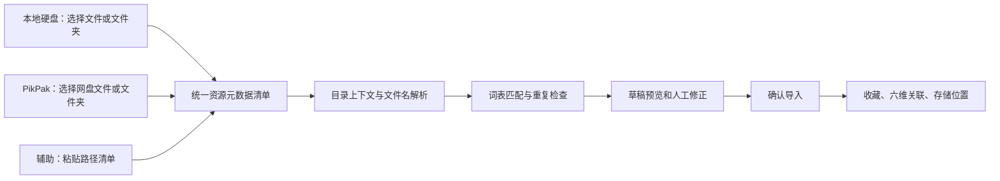

# 来源解析与导入开发计划

日期：2026-10-08。状态：已完成第一步来源无关解析核心及管理员预览，详见 [解析模块](parsing-module.md)。其余为后续计划。最新优先事项为 [PikPak 分享链接管理与观看](pikpak-share-playback-design.md)：只做人人可添加、解析、管理和观看的公共分享模块，不设置角色或发布流程；本来源导入计划及收藏／标签联动暂不纳入该模块的交付。下文 P0—P6 保留完整来源导入路线，不代表下一步必须先完成账号连接，也不把浏览／播放当作确认入库。

## 1. 已确认范围

- 主要入口为本地硬盘和 PikPak。用户选择来源及文件／文件夹后，系统在导入流程中自动解析名称与目录，预填资源信息，预览确认后进入资源库管理。粘贴路径仅为辅助入口，不是主要使用流程。
- “导入”指录入资源信息、六维关联和原始位置，不是搬运或上传原文件。日常流程为：选择来源 → 选择文件／文件夹 → 自动解析 → 展示导入预览 → 确认进入资源库。
- 保留 TYPE、WORK、CHARACTER、SKIN、CLOTHING、CREATOR 六个维度。用户已确认沿用原设计，zw 等仍归内容类型，不新增动作／姿势维度。
- 文件名规则：创作者－皮肤（目录没有时）－服装属性（可选、多项）－内容类型。字段允许缺省，不能按固定位置机械填充。
- 分类文件夹规则：游戏或动漫名称－角色－皮肤（可选）。这里的横杠描述一个文件夹名称内的字段，不假设每个字段必定是一级目录。
- 皮肤属于角色；角色可关联作品范围；服装与创作者独立。解析必须沿用现有归属、停用、版本与权限检查。
- 原文件继续留在硬盘或网盘。第一版仅提交名称、路径及用户选择的元数据，服务端不读取本地文件内容。
- 解析得到草稿，用户预览确认后才创建收藏、位置和标签关联。

## 2. 当前实现与新增模块

已核对代码：现有 SourceService 管理来源及手动状态；CatalogService 管理外部位置；V2AssetService 管理六维直接关联与角色／作品推导。现有 ResourceNameParser 已实现 name-v1 规则与管理员预览；当前没有扫描器、持久化导入批次或路径唯一约束。

沿用 Java／Spring Boot、JdbcTemplate、MySQL、Flyway 和 Vue。第一版使用有上限的分批请求和数据库持久化草稿，不引入消息队列、搜索集群或 AI 服务。业务解析放在后端，多个入口共用同一规则和确认流程。



## 3. 入口与分期

| 入口 | 计划阶段 | 输入与边界 |
| --- | --- | --- |
| 本地硬盘：选择文件／文件夹 | 核心入口，先交付 | 采集名称、相对路径及可选大小／修改时间，选择后自动进入解析预览；兼容性在目标浏览器实际验证 |
| PikPak：选择文件／文件夹 | 核心入口，提前验证接入后交付 | 读取用户选定的网盘目录结构和文件元数据，复用同一解析及入库流程；授权和目录读取方式尚待验证 |
| 粘贴路径清单 | 辅助入口，与共用能力一起实现 | 每行一个路径，可附目录上下文；用于补录、调试或连接暂不可用时的明确降级，不替代两个核心入口 |
| CSV 导入 | 第二版 | 固定模板映射标题、位置、六维名称；进入同一预览，不直接写正式库 |
| 网盘名称／路径清单 | 第二版 | 先支持用户复制或导出的文字清单；不要求网盘登录连接 |
| 链接加介绍文字 | 第二版 | 用户提供原页面链接及文字；保存链接并提取候选，仅有链接时不承诺获得标题或文件列表 |
| 本地扫描工具 | 第三版 | 按选定根目录增量生成清单，可取得完整本地路径；与云服务授权和设备身份单独设计 |
| 百度网盘连接器 | 后续调研后决定 | 验证接口、授权、限流和目录能力，不预设可用性；PikPak 已列入核心主线 |
| 内容识别、AI 打标、封面处理 | 后续独立议题 | 不属于命名解析首版 |

浏览器目录入口不能假设获得真实绝对路径。将“选中的目录”映射到用户填写的来源根路径，预览展示拼接结果，避免重复目录名。没有可靠根路径时保留待补位置草稿，不伪造本地路径。云服务器不能直接扫描用户电脑硬盘。

PikPak 接入先完成技术验证：确认可用的授权方式、目录分页、文件／父目录标识、路径还原、限流和授权失效处理。成功读取选中范围的真实元数据后才进入共用解析器。若无法可靠接入，明确报告阻塞与可选降级方案，不能用粘贴清单冒充已实现 PikPak 导入。账号凭据不混入收藏或草稿 JSON；连接凭据的保存、撤销及最小读取权限在接入验证阶段确定。

## 4. 收藏划分

导入时先选择条目粒度，预览中明确一行将生成什么：

- 默认每个视频文件一条收藏；压缩包默认 OTHER，不读取内部内容。
- 图集模式由用户明确选择一组文件或一个具体资源目录作为一条收藏，位置指向资源目录。
- 游戏／角色分类目录不能自动作为一份图集；其中可能有不同创作者、多个视频和套图。
- 多种文件混合、包含多个子资源目录时提示人工分组；第一版不按“最近父目录”猜测整套资源边界。
- 未支持的扩展名标记 OTHER 或跳过，由用户确认；扩展名只作为文件形式提示，不作为内容真实性证明。

## 5. 解析规则

### 5.1 目录上下文

用户在预览中指定哪一级目录承担分类规则；上层磁盘目录、下载目录、日期目录不参与默认字段提取。先支持单个分类目录名模板，后续再扩展“作品／角色／皮肤”多层目录模板。

目录优先匹配已有作品，再在其范围内匹配角色，再匹配该角色的皮肤。未知名称保留候选文本。作品或角色无法确认时，不能直接创建一个挂错归属的皮肤。

### 5.2 文件名

保留原名称，移除最后一个已知扩展名后解析。匹配副本按现有词表的 NFC、首尾空白及大小写规则处理；真实路径不按标签规则统一改写。

文件名首段是创作者候选，其余结合已知皮肤、服装和类型词表解释。多项服装先支持横杠分段，以及规则中明确配置的分隔符；连续文字如“黑丝高跟鞋”仅在词表切分结果唯一时提出候选，有多种切法就标记歧义。

不能凭末尾位置认定未知词一定是 TYPE，也不能凭缺省字段数量认定第二段一定是皮肤。名称含横杠时先尝试已有实体完整名称匹配；出现多种有效拆法进入人工确认。首版不允许用户输入任意可执行脚本或不受限正则。

### 5.3 优先级与冲突

1. 人工修正并锁定的值优先，重新解析不覆盖。
2. 已确认目录上下文提供作品、角色和可选皮肤。
3. 目录无皮肤时，文件名可补充该角色的皮肤。
4. 文件名与目录明确出现不同皮肤时显示双方依据，阻止该行直接导入；目录优先不等于静默丢弃矛盾信息。
5. 类型和服装只来自明确文字或本批次人工默认值，不从游戏、角色或皮肤推断。
6. 同名创作者不按昵称自动合并，同名角色按作品区分，同名皮肤按角色区分。

每项候选显示状态“匹配已有／建议新建／有歧义／未识别”，并附原始片段、来源目录或文件名、匹配实体与归属。首版不用缺乏校准依据的置信度百分比。

示例（名称仅沿用用户举例，不核定官方设定）：

```text
王者荣耀-公孙离-离恨烟/博主甲-高跟鞋-黑丝-zw.mp4
→ 作品：王者荣耀；角色：公孙离；皮肤：离恨烟
→ 创作者：博主甲；服装：高跟鞋、黑丝；类型：zw；文件形式：视频

王者荣耀-公孙离/博主甲-离恨烟-高跟鞋-zw.mp4
→ 文件名补充皮肤，其余同上
```

目录规则只写明作品、角色时按直接标注保存；皮肤同样记录明确文字依据。有效标签继续使用现有推导规则，不把推导结果伪装成文件名识别结果。

## 6. 预览与人工修正

新增管理员“导入资源”入口，主要选项为“本地硬盘”和“PikPak”，辅助选项提供粘贴路径。流程为：选择来源 → 选择文件／文件夹及条目粒度 → 自动解析 → 预览修正与确认 → 导入结果。目录分类上下文在预览中可调整，无需先到标签管理逐条建立所有实体。

系统自动预填标题、六维候选、文件形式与来源位置。正常匹配项支持批量确认，用户重点处理未识别、冲突、重复和建议新建项；自动解析不等于未经确认写入正式资源库。

预览提供标题、原路径、六维候选、未识别片段、重复提示和状态；详情展示候选依据。可按需确认新建实体、替换已有实体、清除误识别项、跳过记录，以及对选中行批量设置创作者、类型或目录上下文。

批量修正必须先显示影响行数；不同角色的皮肤不能统一套用一个父角色。共享的新实体草稿先去重并统一归属，提交时按作品→角色→皮肤的顺序创建。空词表也可使用，但所有新实体由管理员明确确认；不能要求用户先手动建立整套词表才能导入。

未识别文本允许保留在草稿，用户可明确选择忽略后导入已确认字段；未解决归属冲突、同名实体歧义或缺少可靠位置时，该行不可导入。只有最终候选集合已复核的行可提交。

## 7. 重复判断与提交一致性

- 同批次“来源＋位置类型＋规范化位置”完全相同的输入折叠，并展示重复次数。
- 已有相同来源位置，默认跳过；若对应多个现有收藏，显示冲突，不能任意取第一条。
- 同名、同大小仅提示疑似重复，不等于同一资源。跨硬盘／网盘副本需用户指定“关联已有收藏并追加位置”。
- PikPak 若能提供稳定文件标识，优先用“连接账号／来源作用域＋文件标识”识别同一云端资源，同时保留路径快照；改名或移动不能仅凭路径变化重复创建。该能力须在接入验证中确认，不把临时下载链接用作长期资源身份。
- Windows、本地其他系统和网盘路径采用明确的不同规范化策略。保留原始字符串；不统一把所有路径转小写，不自动移除 URL 查询参数。路径改名可能无法识别为同一文件，首版不承诺内容级去重。
- 同一草稿项只成功执行一次；网络重试、重复点击和失败重试不重复创建。使用批次项执行记录与数据库唯一约束落实，不能只禁用按钮。
- 每行在一个事务内创建必要词表、收藏、关联、位置，并记录结果；失败整行回滚，其他已成功行保留。失败项可修正后重试，结果页明确成功、跳过和失败数量。
- 提交校验批次／行版本以及依赖实体版本和可用性；来源、角色归属、词表被修改后相关行要求重新复核。追加现有收藏检查 asset.version，且不覆盖已有手动标签。
- 复用现有业务服务验证，并统一锁顺序：导入批次／项→FACET_CATALOG→TAG_TREE→收藏行；涉及来源及位置锁时先审查现有路径，保证所有调用无反向顺序。禁止只做“先查再写”防重。
- 导入路径级去重在同一协调锁内查当前位置并写入，覆盖两个并发批次。现有手动位置入口也必须参与相同检查策略，或明确报告其重复冲突，不能把导入幂等误称为全库路径唯一。

第一版建议每批最多 500 个清单项、每次执行最多 50 行；每行独立事务，前端继续请求下一组并可中止未执行部分。数值为待压测的工程上限，实施时固定字节数／路径长度限制，不能将上限视作性能承诺。

## 8. 数据结构草案

新建 Flyway 迁移，保留现有表和六维接口。

| 表 | 主要用途 |
| --- | --- |
| import_batch | 发起管理员、来源、入口、规则版本、分类目录与根路径设置、状态、版本、计数与时间 |
| import_item | 原始名称／路径、条目粒度、规范化定位键、候选与依据 JSON、人工决策 JSON、状态、行版本、执行结果与错误摘要 |
| import_rule | 命名规则和受限选项、版本、启停；首版内置一个可配置模板，规则执行代码有独立版本 |
| import_item_result | 批次项唯一成功记录、目标收藏／位置、提交摘要；与业务写入同事务 |

为 PikPak 预留连接记录及外部资源身份映射：连接绑定来源和账号作用域，资源映射保存外部文件 ID、父目录 ID、路径快照与正式收藏／位置引用。具体表和授权字段在接入验证后定稿；稳定身份不仅留在草稿，避免清理草稿后失去防重依据。

import_item 对批次内定位键建立唯一约束；若使用 SHA-256 缩短索引，还要对比原始规范化值，碰撞时报告而不是合并。共享新实体候选用稳定草稿引用识别，不能只以显示名称关联父节点。

草稿记录引用的既有实体 ID／版本、原始依据和人工修正，供恢复及复核。正式六维事实继续保存在现有关系表；JSON 只承担草稿和审计，不替代检索模型。

批次状态：DRAFT → REVIEW → APPLYING → COMPLETED／PARTIAL；未执行批次可取消。行状态与候选状态分开：PENDING／READY／SKIPPED／SUCCEEDED／FAILED。进程异常时依靠事务结果恢复，不将未确认成功的行永久标为完成。

支持管理员显式删除过期草稿；已导入结果保留最少审计信息。删除批次不连带删除收藏。首版不做批次一键回滚，以免删除导入后又被手动编辑的收藏。

## 9. 接口与代码拆分草案

以下均为拟新增接口，尚未实现：

| 接口 | 用途 |
| --- | --- |
| POST /api/v2/imports | 创建来源和规则绑定的批次，支持客户端请求 ID 防重复创建 |
| POST /api/v2/imports/{id}/items | 分批提交文字清单，校验批次版本及请求 ID |
| POST /api/v2/imports/{id}/parse | 生成或重算候选，保留锁定的人工修正 |
| GET /api/v2/imports/{id} | 批次配置与进度 |
| GET /api/v2/imports/{id}/items | 分页、按状态查看草稿 |
| PATCH /api/v2/imports/{id}/items/{itemId} | 按版本确认、修正或跳过 |
| POST /api/v2/imports/{id}/apply | 按明确选中的 READY 项及版本执行，限量、幂等 |
| POST /api/v2/imports/{id}/cancel | 取消未执行部分，保留已成功结果 |

后端分为输入适配、纯规则解析、词表解析与归属匹配、草稿管理、重复检查、事务提交六个模块。解析器本身不写正式数据。前端复用 FacetPicker、角色／皮肤归属展示、来源选择及冲突提示。

输入适配统一输出来源、入口类型、文件／目录名称、相对或云端路径、父目录上下文、条目类型及可选大小／修改时间；PikPak 另带账号作用域和外部文件标识。连接授权、目录分页及读取选中范围的接口在能力验证后补充，不假定现有来源管理接口已具备这些功能。

所有导入接口仅 ADMIN，保留 Session／CSRF；服务端同时校验管理员与批次归属。VIEWER 只能浏览最终正式收藏，不能查看导入草稿中的未发布路径与名称。日志不输出完整清单；来源文字按纯文本显示。链接输入仅作为元数据，不触发服务器抓取。

## 10. 开发阶段与验收

| 阶段 | 交付 | 验收门槛 |
| --- | --- | --- |
| P0 规则与来源验证 | 脱敏样本、条目粒度、目录模板；本地选择能力与 PikPak 授权／目录读取验证 | 命名边界明确；PikPak 接入可行性有实际证据，限制或阻塞提前记录 |
| P1 共用解析与草稿 | 迁移、统一元数据契约、纯解析器、词表匹配、分页预览；辅助粘贴清单用于联调 | 空词表可形成候选；解析和取消不改变正式收藏；zw进入TYPE |
| P2 确认入库闭环 | 行编辑、新建实体确认、重复检查、幂等提交、失败重试 | 一条输入能生成正确收藏；双击／并发批次无重复；错误行无残留关联 |
| P3 本地硬盘导入交付 | 文件／文件夹选择、相对路径采集、根路径映射、视频／图集分组和自动解析 | 选择本地资源后可预览确认进入资源库；无文件字节上传；分类目录不误合并资源 |
| P4 PikPak 导入交付 | 基于 P0 结果实现连接、目录浏览选择、元数据读取、自动解析和稳定身份记录 | 真实授权范围内选中文件／文件夹可进入同一预览及入库流程；验证分页、失效、限流及重复导入 |
| P5 核心流程回归 | 权限、并发、异常恢复、真实MySQL测试、操作文档 | 两个核心入口分别验收；原收藏功能回归通过；清楚列出未验证能力 |
| P6 扩展入口与同步 | CSV、其他网盘清单、链接文字、本地增量工具、百度网盘调研 | 复用共用逻辑；自动同步另行定义改名、移动和删除语义 |

开发主线为“共用解析与入库能力 → 本地硬盘导入 → PikPak 导入”。PikPak 技术验证在 P0 提前进行，不推迟到开发末期。本地入口可以先独立交付，但只有两个核心入口均实际验收后，才称主要来源导入完成；粘贴路径是辅助能力。

核心测试：目录与文件名冲突、同名不同原作、未知创作者含横杠、皮肤跨角色、停用链、未知扩展名、重复路径、跨来源副本、多文件图集、断网重试、并发提交、预览后实体被改、解析不覆盖人工修正、管理员会话失效、看客伪造请求。

来源专项测试：本地根路径映射与多选、PikPak 分页完整性和选中范围边界、授权过期、限流重试、同名不同目录、文件改名／移动后的身份识别；两类入口解析同样的目录与文件名时应得到相同候选。

## 11. 实施前需用样本核实的假设

- 分类信息主要写在一个文件夹名称内，还是已存在多级作品／角色／皮肤目录。
- 多个服装属性通常怎样分隔，创作者名称是否经常包含横杠。
- 视频是否通常一文件一收藏；图集是否有独立资源目录，还是散图直接放角色目录。

这些不阻止先建立解析器和草稿基础，但正式规则验收前需要少量脱敏路径样本。zw归TYPE已经确认，不再作为待定项。
